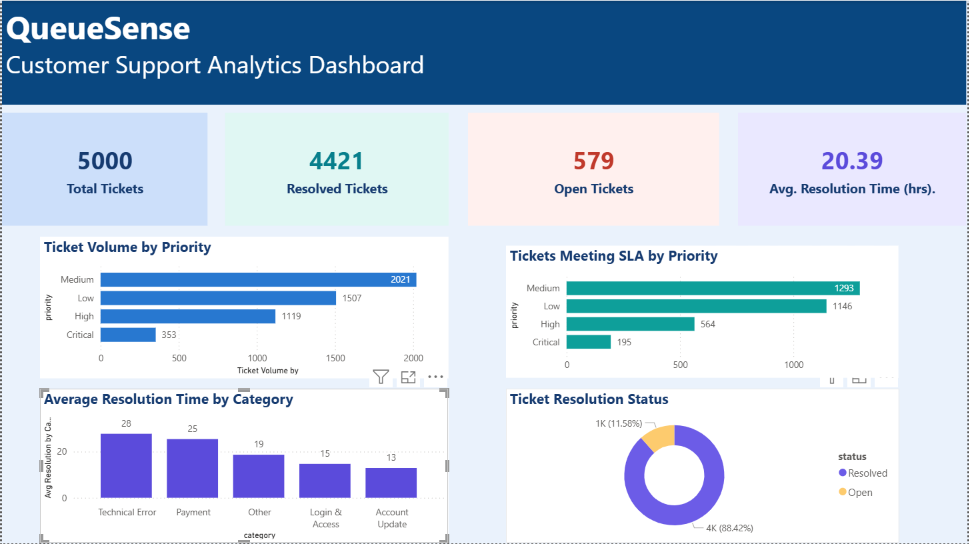

# QueueSense — Customer Support Analytics Dashboard

A data analytics portfolio project using **Python, Pandas, SQL, SQLite, and Power BI** to analyze customer support tickets, resolution times, and SLA performance.

## Project Overview

QueueSense helps analyze customer support operations by answering questions such as:

- How many support tickets are open and resolved?
- Which ticket priorities receive the most requests?
- Which categories take the longest to resolve?
- How effectively are support tickets meeting their Service Level Agreement (SLA) targets?

The project uses a simulated dataset of **5,000 support tickets** to demonstrate a complete data analytics workflow, from data generation and validation to SQL analysis and dashboard reporting.

## Dashboard

The Power BI dashboard summarizes ticket volume, resolution status, average resolution time, and SLA performance.



To explore the dashboard interactively, download `powerbi/QueueSense_Dashboard.pbix` and open it using Power BI Desktop.

## Tools and Technologies

| Technology | Purpose |
|---|---|
| Python | Data generation and analysis |
| Pandas | Data manipulation, validation, and KPI calculations |
| SQL | Querying ticket data and calculating summaries |
| SQLite | Storing and querying ticket records |
| Power BI | Visualizing KPIs and business insights |
| CSV | Storing the dataset and analysis reports |

## Project Structure

```text
QueueSense/
├── data/
│   └── support_tickets.csv
├── reports/
│   ├── category_resolution_summary.csv
│   └── dashboard_summary.csv
├── powerbi/
│   ├── QueueSense_Dashboard.pbix
│   └── dashboard_screenshot.png
├── analyze_tickets.py
├── export_dashboard_data.py
├── generate_data.py
├── load_database.py
├── query_database.py
├── schema.sql
├── sla_analysis.py
├── validate_data.py
├── README.md
└── .gitignore
```

The SQLite database file, `data/queuesense.db`, is generated locally by the database loading script and is excluded from GitHub.

## How the Project Works

### 1. Generate the dataset

The data generation script creates 5,000 simulated customer support tickets with fields such as ticket ID, creation date, category, priority, assigned agent, status, resolution time, and SLA target.

Script: `generate_data.py`

### 2. Validate data quality

The validation script checks the dataset for duplicate ticket IDs, missing values, ticket status counts, and invalid resolution times.

Script: `validate_data.py`

Missing resolution times for open tickets are expected because those tickets have not yet been resolved.

### 3. Store data in SQLite

The SQL schema defines the support ticket table. The loading script imports the CSV records into the SQLite database.

Files:
- `schema.sql`
- `load_database.py`

### 4. Analyze tickets using Python and SQL

The project calculates ticket counts, average resolution time, category-level resolution averages, and SLA compliance by priority.

Scripts:
- `analyze_tickets.py`
- `query_database.py`
- `sla_analysis.py`

### 5. Export dashboard summaries

The export script generates a summary dataset used for dashboard reporting.

Script: `export_dashboard_data.py`

Output: `reports/dashboard_summary.csv`

### 6. Visualize the results

The Power BI dashboard displays:
- Total, open, and resolved ticket KPIs
- Ticket volume by priority
- Tickets meeting SLA by priority
- Average resolution time by category
- Ticket resolution status

## Dataset Information

- Total records: 5,000
- Columns: 9
- Resolved tickets: 4,421
- Open tickets: 579

The dataset is simulated for educational and portfolio purposes. It does not represent real customers or real support operations.

## Key Findings

### Ticket resolution

- Average resolution time for resolved tickets: **20.39 hours**
- Technical Error tickets have the longest average resolution time: **27.74 hours**
- Payment tickets have an average resolution time of **25.43 hours**

### SLA performance

| Priority | Tickets meeting SLA | Resolved tickets | SLA compliance |
|---|---:|---:|---:|
| Critical | 195 | 329 | 59.3% |
| High | 564 | 994 | 56.7% |
| Medium | 1,293 | 1,800 | 71.8% |
| Low | 1,146 | 1,298 | 88.3% |

High-priority tickets have the lowest SLA compliance among the priority groups in this dataset. This suggests that high-priority support workflows may need further investigation.

## Business Recommendations

Based on the simulated results:

1. Investigate the causes of long resolution times for Technical Error tickets.
2. Review workflows for High and Critical priority tickets to identify SLA delays.
3. Monitor SLA compliance by priority to help identify operational bottlenecks.
4. Track resolution times regularly to measure whether process improvements are effective.

These recommendations are based on the simulated dataset and should not be interpreted as findings about a real business.

## How to Run the Project

### Prerequisites

Install:
- Python 3
- Pandas
- Power BI Desktop (for the dashboard)

### Step 1: Clone the repository

```bash
git clone <YOUR_GITHUB_REPOSITORY_URL>
cd QueueSense
```

Replace the placeholder with your actual GitHub repository URL.

### Step 2: Install the Python dependency

```bash
py -m pip install pandas
```

### Step 3: Validate the dataset

```bash
py validate_data.py
```

### Step 4: Create the SQLite database

```bash
py load_database.py
```

This creates `data/queuesense.db` and imports the CSV records.

### Step 5: Run the SQL priority report

```bash
py query_database.py
```

### Step 6: Run the business KPI analysis

```bash
py analyze_tickets.py
```

### Step 7: Run the SLA analysis

```bash
py sla_analysis.py
```

### Step 8: Export dashboard summary data

```bash
py export_dashboard_data.py
```

### Step 9: Open the Power BI dashboard

Open `powerbi/QueueSense_Dashboard.pbix` in Power BI Desktop.

**Note:** Run these commands from the main `QueueSense` project folder. The scripts use relative file paths. The data-generation script overwrites the existing CSV dataset, so run it only when you intentionally want to regenerate the simulated data.

## Validation

The project has been checked for:
- 5,000 CSV records and 5,000 SQLite records
- Matching ticket IDs, statuses, and categories between CSV and SQLite
- Matching overall and category-level resolution averages
- Matching SLA compliance counts
- SQLite database integrity and duplicate ticket IDs

These checks confirm consistency for the tested results; they do not constitute exhaustive testing of every possible input or business rule.

## Future Improvements

- Add time-based trends for ticket volume and resolution performance.
- Introduce more detailed SLA monitoring.
- Automate dashboard refresh and reporting.
- Test the workflow with real, appropriately anonymized support data when available.

## Project Goal

QueueSense demonstrates practical skills in data preparation, data quality validation, SQL querying, KPI analysis, and business intelligence reporting using Python, SQLite, and Power BI.
